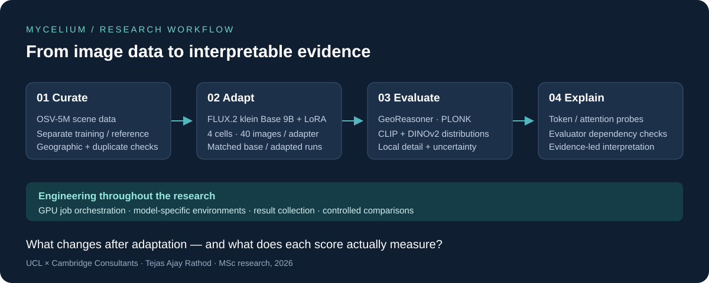
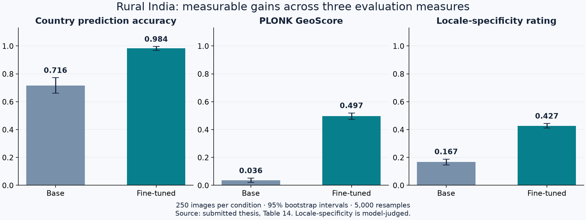
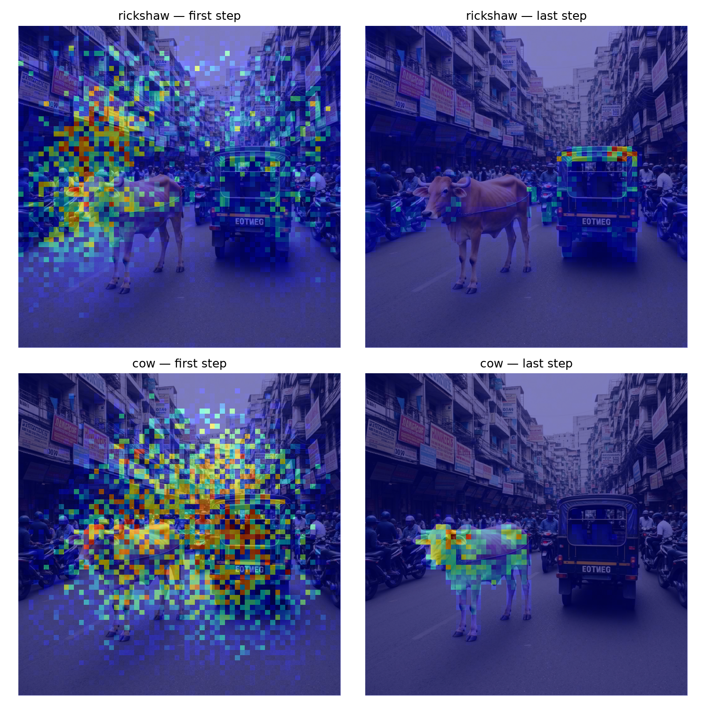

# Mycelium

### Geographic fidelity in generative vision

**Can a text-to-image model capture the character of a place without relying on famous landmarks?**

Mycelium is my MSc research project at **UCL, with Cambridge Consultants**. I built a workflow for dataset curation, controlled LoRA fine-tuning, automated evaluation and architecture-level investigation of both the generator and its evaluators.



[Findings](docs/findings.md) · [Visual explainability](docs/explainability.md) · [Method](docs/methodology.md) · [Code guide](docs/code-guide.md) · [Reproduce the figures](docs/reproduction.md)

## The distribution argument

A scene can look believable and be easy to geolocate while still missing the everyday variation of the place it depicts. My research separates three questions:

| Plausible | Identifiable | Representative |
|---|---|---|
| Could this scene occur there? | Can the country be guessed? | Does the generated set cover ordinary variation? |

**Compare generated scenes with real scenes from the same country and scene type.** This turns geographic evaluation into a test of both recognisability and distributional coverage.

## What I built

- **A controlled benchmark:** held-out real photographs, base generations and fine-tuned generations across India/UK and rural/urban scenes.
- **Four targeted LoRA adapters:** FLUX.2 klein Base 9B, 40 training images per scene/country combination, with matched prompts and seeds for comparison.
- **An automated research workflow:** image curation, GPU job orchestration, model evaluation and result collection.
- **An evaluator audit:** token and attention probes, forced-label tests and distributional analysis that help explain what improved scores actually mean.

## A measurable improvement, backed by diagnostics

For **rural India**, GeoReasoner accuracy increased from **71.6% to 98.4%**, and mean PLONK GeoScore from **0.036 to 0.497**. Each condition contained 250 images; uncertainty was estimated with 5,000 bootstrap resamples.



The contribution goes beyond improving a score. Comparing against real photographs showed that **country recognition and real-image distribution coverage are distinct objectives**. CLIP and DINOv2 recall remained zero across the four tested cells, while geographic and local-detail measures changed. This makes the evaluation useful for deciding what to optimise next.

[Read the full four-cell comparison and interpretation →](docs/findings.md)

## Research through three connected questions

| Question | What I did | What it enables |
|---|---|---|
| Can small-data adaptation improve geographic identity? | Trained cell-specific adapters and compared against the same base model | Measures the effect of fine-tuning with controlled prompts and seeds |
| Do better scores imply similarity to real scenes? | Compared held-out real and generated sets in CLIP and DINOv2 feature spaces | Separates geographic identity from distributional coverage |
| Can we trust the evaluators' explanations and agreement? | Investigated generator attention, GeoReasoner continuations and PLONK behaviour | Guides interpretation and more informative future evaluation |

## Looking inside the models

I used interventions alongside attention visualisations to investigate **where words are grounded, when content becomes fixed and whether evaluator explanations are reliable**.



*From my research presentation: word-to-image attention checked against detected object locations. These probes help identify useful control points; attention alone does not establish causal control.*

[Explore the visual findings: what I tested, what changed and why it matters →](docs/explainability.md)

## Explore the repository

```text
mycelium-research/
├── README.md                 Project overview
├── docs/                     Findings, methodology and code/reproduction guides
├── assets/                   Architecture diagram and result figures
├── results/                  Thesis-derived tables with source references
├── src/mycelium/             Distributional metrics and experimental prompts
├── reference/                Original training, explainability and orchestration code
├── scripts/                  Rebuild the result figures locally
└── tests/                    Lightweight release integrity checks
```

**Start locally, without a GPU:**

```bash
python -m venv .venv
source .venv/bin/activate
python -m pip install -r requirements-figures.txt
python scripts/plot_results.py
python -m unittest discover -s tests -v
```

These commands recreate charts from the included thesis tables and check release consistency. Full model experiments require external data, model access and GPU environments; see the [reproduction guide](docs/reproduction.md).

## About this release

This is a curated companion to the research archive. The code guide distinguishes reusable analysis from environment-specific experiment scripts. The findings apply to the tested model, data and protocol; no human-participant evaluation was conducted.

**Author:** Tejas Ajay Rathod  
**Supervisors:** Dr John Smeaton, Cambridge Consultants; Prof Lourdes Agapito, UCL  
[GitHub](https://github.com/TejasARathod) · [ORCID](https://orcid.org/0000-0002-0497-5177)

See [provenance and attribution](docs/provenance.md) for source mapping and third-party components.
