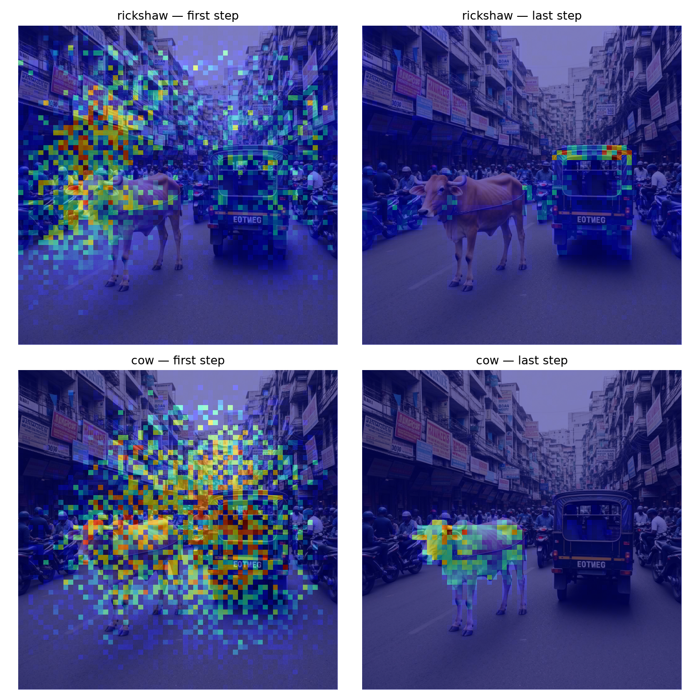
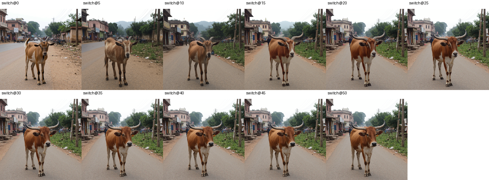
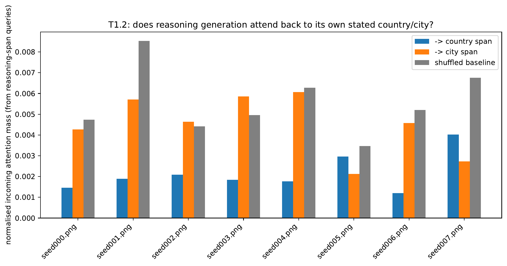
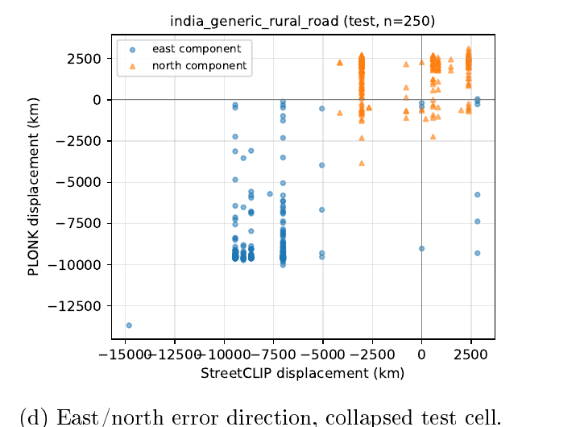
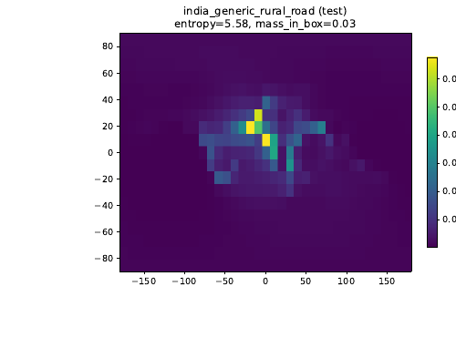
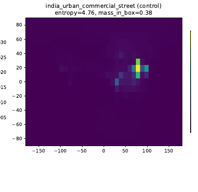
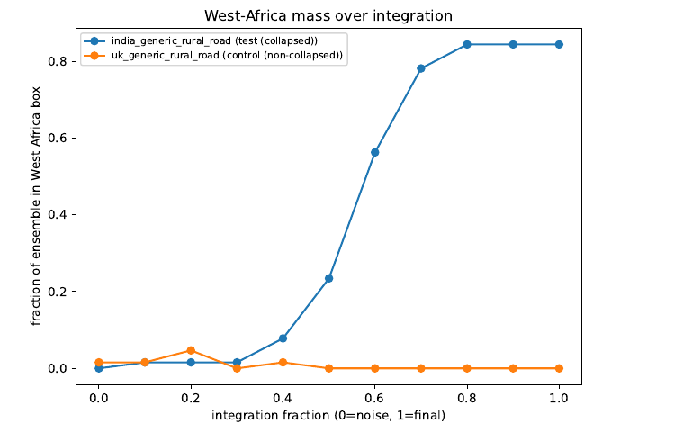

# Inside the generator and its evaluators

[← Overview](../README.md) · [Aggregate findings](findings.md)

These figures and explanations are adapted from my presentation, **The Distribution Argument**. They show how I used mechanistic tests to make model outputs easier to interpret and identify promising directions for future work. Small diagnostic samples are reported explicitly; they are not population-wide estimates.

## 1. Find control points by testing them

### Words map to image regions

**Test.** Compare word-to-image attention with object locations detected by Grounding DINO.

**Finding.** In the reported klein 4B probe, 9 of 10 objects were detected; all detected objects had above-chance attention localisation, averaging 3.8× chance.

**Use.** Establishes a spatial connection between explicit prompt cues and depicted objects, motivating targeted intervention experiments.

### Content becomes harder to change later in generation

**Test.** Swap concepts during sampling, including cow/goat, dog/cat and bicycle/motorcycle.

**Finding.** Concept swaps succeeded in 3/3 tested pairs at step 0 and 0/3 by step 40.

**Use.** Prioritises early intervention when exploring control of scene content. The result describes these probes, not a universal transition step.

### Attention magnitude is not a control map

The presentation reports a token receiving 73.9× more attention than comparison tokens, yet removing its encoded output retained image CLIP similarity of 0.881. This motivated testing interventions rather than interpreting bright heatmap regions as causal controls.

## 2. Audit explanations as well as predictions

**Question.** Does GeoReasoner's written explanation reliably show how it selected a location?

**Test.** Measure attention from reasons back to the country/city answer against a shuffled baseline, then force alternative answers and let the model continue.

**Finding.** In eight images, reasoning-to-country attention was below the shuffled baseline in 8/8. A forced incorrect Japan/Tokyo answer was defended in 3/8 cases. The answer precedes the reasons in the output format, so this audits the continuation rather than proving the original prediction mechanism.

**Use.** Treat country prediction and explanatory faithfulness as separate evaluation targets. A fluent explanation cannot serve as its own validation.

## 3. Separate agreement, confidence and correctness

### Shared encoders require dependency checks

**Test.** Compare PLONK and StreetCLIP errors on 250 collapsed India-rural images and control sets.

**Finding.** The presentation reports direction agreement of 0.878, versus 0.57–0.66 in controls. PLONK uses the same frozen StreetCLIP checkpoint as the separately queried evaluator.

**Use.** Avoid counting related model outputs as two independent confirmations. This dependency concerns PLONK and StreetCLIP specifically.

### Inspect the whole geographic likelihood

**Test.** Inspect likelihood grids for five images per condition, rather than only the highest-scoring coordinate.

**Finding.** The failed India-rural group had mean probability mass of 0.010 inside the India box. Some distributions were concentrated in the wrong region rather than simply diffuse.

**Use.** Distinguish uncertainty from confident mislocalisation when interpreting a geographic score.

| India-rural example | India-urban control |
|---|---|
|  |  |

### Track how a prediction develops

For one failed India-rural image and one UK-rural control, I followed 64 particles through 11 sampling checkpoints. In the failed example, West Africa overtook India at the 40% checkpoint and reached 54/64 particles at the end.

This localises **when** the preference developed, giving a more informative diagnostic than a final coordinate. It does not establish its cause or guarantee that the same trajectory occurs for other images.

## What these investigations contribute

Together, these tests connect observed results to specific questions about conditioning, generation timing, representation sharing and explanation reliability. They help define what to test next, rather than relying on a single score or a convincing-looking explanation.

Figures were extracted unchanged from the author's offline presentation. The [asset manifest](presentation-assets.json) records their provenance. Original implementation examples are indexed in the [code guide](code-guide.md).
