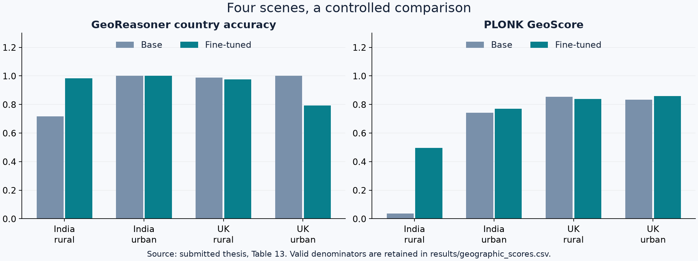

# Findings: making geographic evaluation more informative

[← Overview](../README.md)

## 1. Targeted adaptation improved rural-India geographic identity

Four adapters were trained for four country/scene combinations. Rural India provided the clearest improvement: GeoReasoner increased from 179/250 correct predictions to 246/250; PLONK GeoScore increased from 0.036 to 0.497. Their within-condition 95% bootstrap intervals did not overlap.

| Cell | GeoReasoner base | Fine-tuned | PLONK base | Fine-tuned |
|---|---:|---:|---:|---:|
| India rural | 179/250 | 246/250 | 0.036 | 0.497 |
| India urban | 249/249 | 250/250 | 0.741 | 0.770 |
| UK rural | 247/250 | 244/250 | 0.854 | 0.838 |
| UK urban | 249/249 | 198/250 | 0.834 | 0.860 |

Source: submitted thesis, Table 13. Two base sets exclude one corrupted image each. Outcomes differ across cells: the result supports targeted adaptation, not a claim of universal improvement.

## 2. The benchmark separates recognition from distributional coverage

Generative recall remained 0.000 before and after adaptation in both CLIP and DINOv2 feature spaces. Generated sets could cover their own held-out halves (approximately 0.83–0.94 recall), yet did not cover held-out real images under the tested neighbourhood metric. The analysis also checked different neighbourhood sizes.

This is a useful diagnostic: a model can become easier to geolocate without covering the variety present in real photographs. Zero empirical recall describes this finite-sample embedding test; it is not a proof that the underlying distributions have mathematically disjoint support or that every generated image is unrealistic.

## 3. Explainability helps evaluate the evaluators

[See the presentation figures and the test → finding → practical use walkthrough](explainability.md).

- **FLUX.2:** token interventions and architecture-level attention probes investigated how text conditioning and image structure interact. Probes support model-specific interpretation; attention alone is not a complete causal explanation.
- **GeoReasoner:** forced-label and attention tests investigated whether a fluent explanation was grounded in the predicted answer. The model could defend an incorrect supplied label in a small diagnostic sample. Written reasons are therefore not treated as independent validation of its prediction.
- **PLONK / StreetCLIP:** shared representation ancestry and correlated behaviour motivated dependency checks. Agreement between related evaluators is not automatically independent corroboration. PLONK likelihood and trajectory diagnostics examined how geographic predictions were formed.

## 4. Practical directions supported by the research

The work motivates separate evaluation of country identity, local detail, structural variety and real-image similarity. Future extensions include broader geographic coverage, independently collected human judgements and more deliberately grounded geographic evaluation. These are research directions, not completed experiments.

## Evidence trail

See [source tables](../results/README.md), [methodology](methodology.md) and [code provenance](code-provenance.json). Quantitative results above come from the submitted thesis, rather than earlier planning notes or composite-score drafts.
